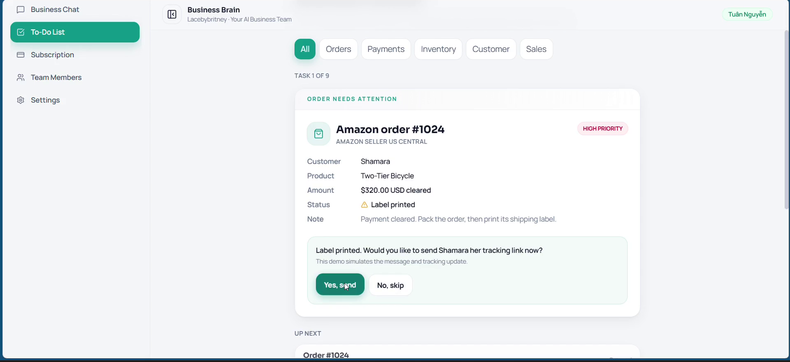
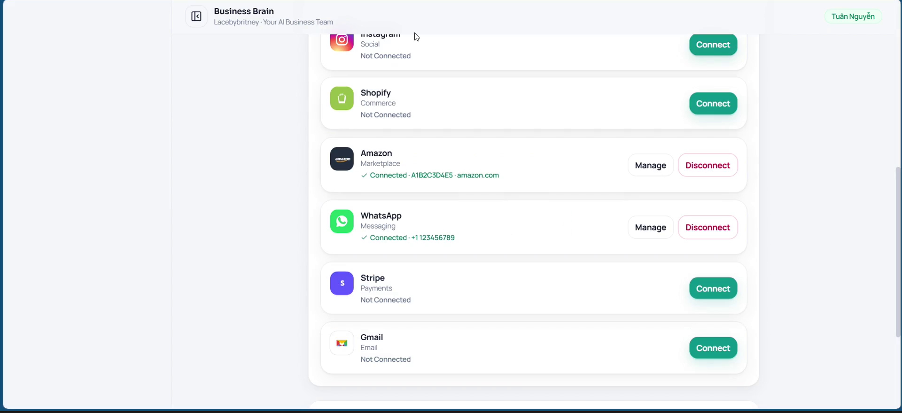
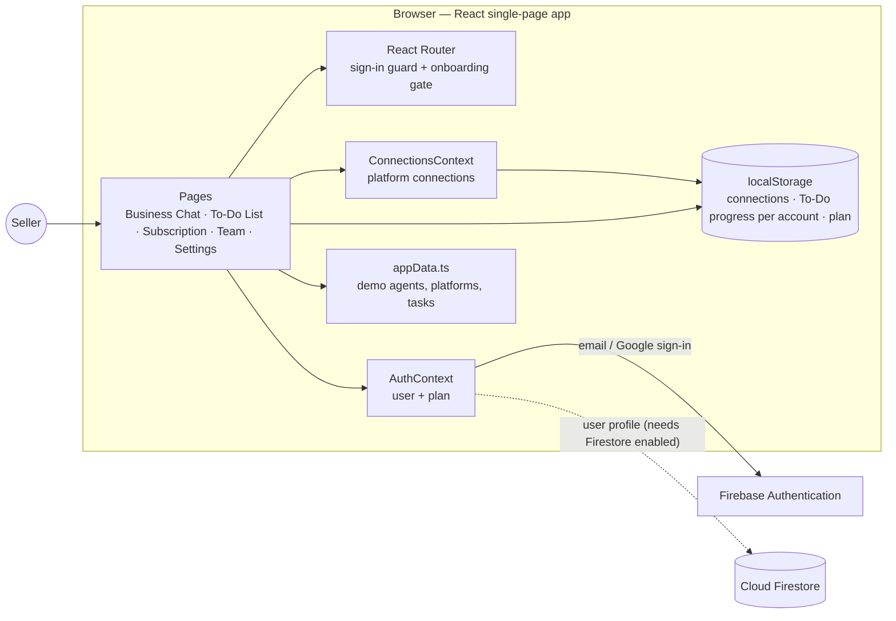
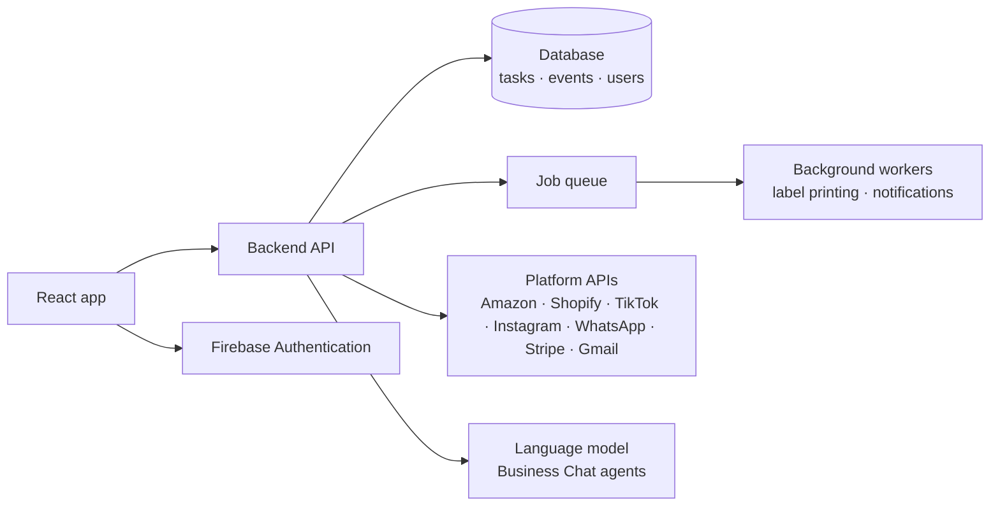

# Business Brain

One workspace that turns a small online seller's scattered orders, messages, and payments into a clear, prioritized list of next actions.

Built for the [Next Founders Hackathon](https://next-founders.devpost.com/).

**Demo video:** https://youtu.be/MbtsHgW6_qc



## Local AI chat with OpenRouter

Business Chat can now call OpenRouter through a local Node backend. See [backend setup](backend/README.md). Put your key in `backend/.env`, start the backend with `npm start`, and run Vite in a second terminal. This integration uses sample business tasks and does not execute platform actions. The prototype descriptions below document the earlier hackathon version.

## The problem

Small online sellers run their business across many apps: TikTok and Instagram for marketing, Amazon and Shopify for orders, WhatsApp and Gmail for customers, and Stripe for payments. Switching between them all day makes it easy to miss a follow-up or ship an order late. Business Brain gives a solo merchant or small team one place to see what needs attention and act on it.

## Features

- **Connect your apps:** platform-specific setup for TikTok, Instagram, Shopify, Amazon, WhatsApp, Stripe, and Gmail. For example, choose a TikTok or Instagram page, enter a WhatsApp Business number, or pick an Amazon marketplace and Seller ID.
- **Prioritized To-Do List:** the most urgent task appears on top. In the Amazon order example, the seller prints a shipping label, decides whether to send the customer a tracking link, and completes the task without leaving the card.
- **Progress that survives a refresh:** completed tasks and label steps are saved per signed-in account.
- **Business Chat:** choose from seven specialist agents (customer, sales, marketing, inventory, finance, operations, analyst).
- **Plans:** Free, Pro, and Pro Plus subscription tiers.



### Prototype scope

| Works today | Simulated in this prototype |
| --- | --- |
| Google sign-in (Firebase Authentication) | Platform connections and account data |
| Navigation, onboarding, and all user flows | Business Chat replies (no language model yet) |
| To-Do progress saved per account in the browser | Label printing and tracking-link messages |
| Connection state saved in the browser | Subscription changes, invoices, and billing |

## Tech stack

- React 19 and TypeScript
- Vite 8
- Tailwind CSS v4
- React Router v7
- Firebase Authentication (hosted backend for sign-in)
- Lucide icons

## Architecture

### Current prototype

Business Brain is a single-page React app. Firebase Authentication is the hosted backend for sign-in; there is no custom server yet. App state is held in React contexts and saved in the browser.



- **Pages** read demo data from `appData.ts` and shared state from the two contexts.
- **AuthContext** wraps Firebase Authentication and exposes the signed-in user to every page.
- **ConnectionsContext** keeps platform connections in one place, so onboarding and Settings stay in sync.
- **To-Do progress** is stored under a key that includes the signed-in email, and is validated before it is restored.

### Planned production architecture



Moving tasks and events into a database and running slow work (printing, messaging) as background jobs lets the same interface handle more sellers and higher order volume.

## Project structure

```
frontend/src/
├── App.tsx                     # Routes, sign-in guard, onboarding gate
├── firebase.ts                 # Firebase app and Auth setup
├── context/
│   ├── AuthContext.tsx         # Sign-in, sign-up, Google sign-in, plan state
│   └── ConnectionsContext.tsx  # Platform connection state
├── data/appData.ts             # Agents, platforms, and demo tasks
├── components/                 # Layout, connection modal, logos
└── pages/                      # Business Chat, To-Do List, Subscription, Team, Settings
```

State, data, and UI are kept separate so the demo data can later be replaced by real platform APIs without rewriting the interface.

## Run locally

Requires Node.js 20.19 or later.

```bash
cd frontend
npm ci
npm run dev
```

Open the local URL printed by Vite (usually http://localhost:5173). Use **Continue with Google** to sign in. Email sign-up also saves a user profile to Cloud Firestore, so it requires Firestore to be enabled in the Firebase project.

Other commands:

```bash
npm run build   # production build
npm run lint    # lint
```

## Business model

Business Brain targets solo merchants and small ecommerce teams without an operations team. Revenue comes from subscriptions:

| Plan | Price | Includes |
| --- | --- | --- |
| Free | $0 | Three basic agents, basic reports and alerts |
| Pro | $29.99/month or $299.99/year | All seven agents, more connections, up to five team members, automated tasks |
| Pro Plus | $49.99/month or $399.99/year | Custom workflows, multiple businesses, advanced forecasting, higher limits |

Main costs will be hosting, platform API access, and AI usage. Prices are proposed; billing is not active in the prototype.

## Roadmap

- Replace simulated connections with authorized platform APIs.
- Connect Business Chat to a language model.
- Move tasks, events, and user profiles to a backend database (Cloud Firestore).
- Run label printing and notifications as background jobs so the product can serve more sellers and higher order volume.

## License

Released into the public domain under [The Unlicense](LICENSE).
